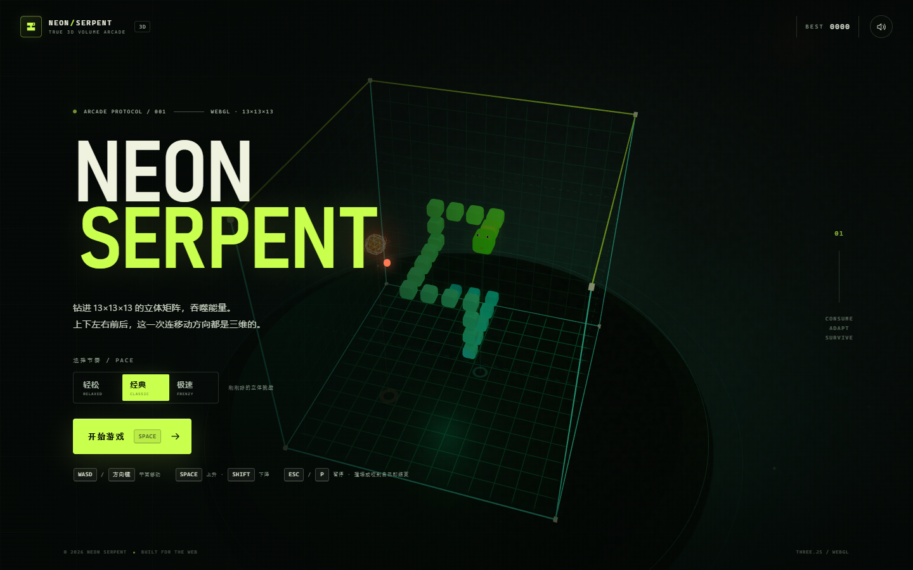
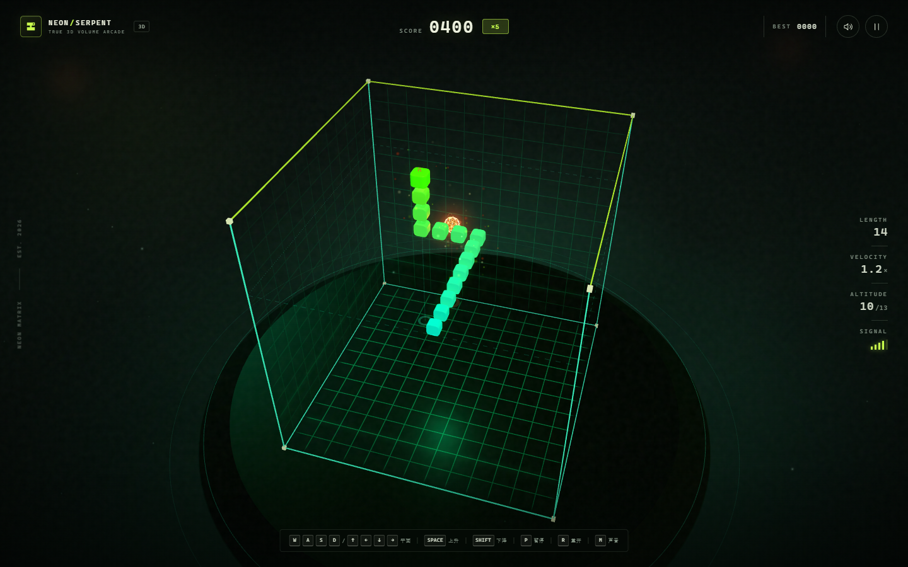

# NEON SERPENT / 3D

一个纯前端、零构建的 **真 3D 霓虹贪吃蛇**。蛇在一个 13×13×13 的立体矩阵里活动，可以在 X / Y / Z 三个轴上转向；不只是画面有透视，移动空间本身也是三维的。场景、蛇、食物与粒子全部由 Three.js 实时渲染，音效由 Web Audio 实时合成，不依赖任何外部图片、字体或 CDN。

## 在线游玩

**[打开 NEON SERPENT](https://kiriusss.github.io/neon-serpent-3d/)**

## 运行

双击 **start.cmd**。脚本会启动一个本地静态服务器，并自动打开：

    http://127.0.0.1:4173

也可以用：

    npm start

或：

    node serve.mjs

> 不要直接双击 index.html。页面使用 ES Module，必须通过 HTTP 打开；直接打开文件时页面会提示通过 start.cmd 启动。

环境要求：支持 WebGL2 的现代浏览器（Chrome / Edge / Firefox / Safari 新版），以及 Node.js（仅用于本地静态服务器）。游戏本身不需要联网。

## 玩法

- **WASD / 方向键**：在水平面内前后左右移动
- **空格 Space**：开始游戏 / 上升 / 暂停时继续
- **Shift**：下降
- **P / Esc**：暂停
- **R**：重开
- **M**：声音
- 手机：滑动屏幕控制平面移动；右下角 **Y+ / Y−** 控制升降
- 进入游戏后蛇会先停住，按任意有效方向键再开始移动，不会一开局就撞墙

规则很简单：吃掉橙色能量球，身体变长、速度变快。撞到立体矩阵的六个面，或者咬到自己，就结束。食物可能悬在不同高度，头顶的虚线方框和地面投影圈会显示蛇当前所在的层。

连续快速进食会累积 **COMBO**，最高 ×5；单颗能量球最高可得 50 分。每吃 3 颗会提升一级速度。

三种节奏：

| 难度 | 初始节奏 | 特点 |
| --- | --- | --- |
| 轻松 | 196 ms / 格 | 适合先熟悉立体移动 |
| 经典 | 154 ms / 格 | 默认速度 |
| 极速 | 116 ms / 格 | 反应测试 |

最高分保存在浏览器的 localStorage 中。

## 技术说明

- **Three.js r186**，vendored 在 vendor/ 下，离线可玩。
- 13×13×13 体素空间；蛇头可在 6 个方向上移动，碰撞检测、食物生成和渲染插值都是三维的。
- 场景包含透视相机、软阴影、自定义网格着色器、程序化发光贴图、叠加混合粒子、合成音效。
- 地面投影圈、垂直引导光柱和当前高度虚线框帮助判断蛇在立体空间中的位置。
- 游戏逻辑位于 js/engine.js，不依赖 DOM，可单独测试。
- 无构建步骤，无 npm runtime 依赖。

## 文件结构

    index.html            页面与界面结构
    css/style.css         全部界面样式
    js/engine.js          纯游戏逻辑
    js/visuals.js         Snake / Food / Particles 三维视图
    js/game.js            场景、循环、输入与 UI 状态机
    js/audio.js           Web Audio 合成音效
    vendor/               Three.js（MIT）
    tests/                Node 单元测试
    serve.mjs             本地静态服务器
    start.cmd             Windows 一键启动

## 测试

    npm test

覆盖了 13×13×13 三维移动、Y 轴升降、吃食物、COMBO 过期、速度提升、六面墙、自撞、尾随格、暂停、立体食物生成与难度切换。

## 许可

游戏代码为项目代码。Three.js 以 MIT 许可分发，许可证见 vendor/THREE-LICENSE.txt。